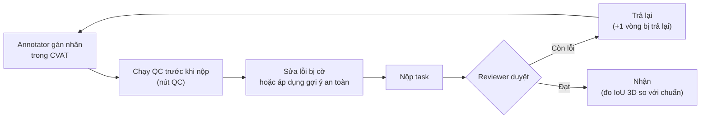
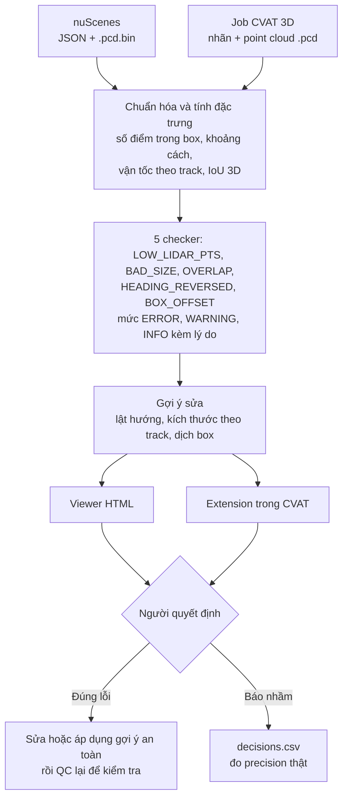
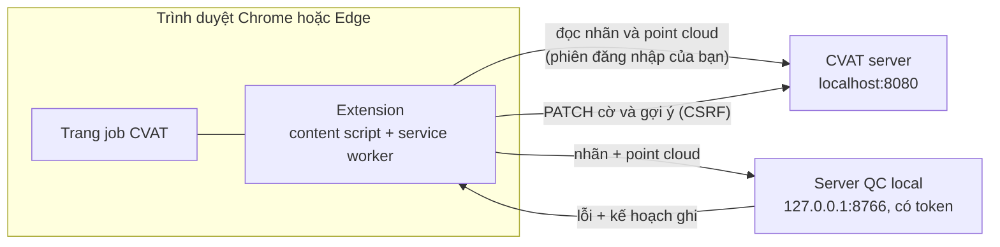
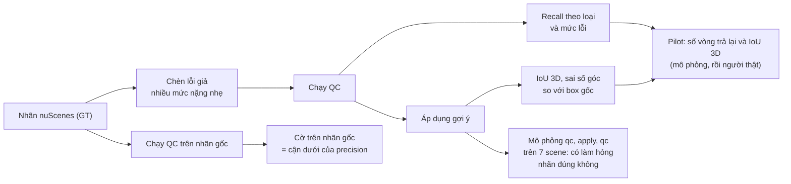

# cvat-lidar-3d-cuboid-annotation-qc

> **Quality control for 3D LiDAR cuboid annotations.** Detects wrong heading, size, position offset, duplicate boxes and
> boxes with too few LiDAR points; suggests fixes; integrates with [CVAT](https://github.com/cvat-ai/cvat) through a browser
> extension. Developed and tested on nuScenes (project N2-04C: *QC cuboid 3D*).
> Keywords: CVAT, LiDAR, point cloud, 3D cuboid, annotation quality, label error detection, nuScenes.

Công cụ kiểm tra chất lượng nhãn **cuboid 3D** trên point cloud LiDAR: tìm box sai hướng, sai kích thước, lệch vị trí, trùng
nhau hoặc quá ít điểm, gợi ý sửa, và dùng trực tiếp trong CVAT (nút **QC** do extension thêm vào trang job).

**Cài đặt và chạy:** xem [`SETUP.md`](SETUP.md). **Trạng thái:** chạy được từ đầu đến cuối trên CVAT 2.81.1 và nuScenes Mini;
chưa có pilot với annotator thật (xem [Giới hạn](#giới-hạn-quan-trọng)).

## 5 checker

| Issue | Phát hiện |
|---|---|
| `LOW_LIDAR_PTS` | Quá ít điểm LiDAR so với class và khoảng cách (box bị che nhiều chỉ là `INFO`) |
| `BAD_SIZE` | Kích thước ngoài khoảng P1–P99 của class (hoặc khoảng định sẵn khi ít mẫu) |
| `OVERLAP` | IoU 3D hoặc tỉ lệ chứa nhau vượt ngưỡng (có danh sách cặp class hợp lệ, ví dụ người + xe đạp) |
| `HEADING_REVERSED` | Hướng box lệch ≥ 120° so với hướng di chuyển (cần ego pose) |
| `BOX_OFFSET` | Dịch box ±1,5 m thấy chỗ chứa nhiều điểm hơn hẳn, bỏ điểm của box khác và vật dài như tường (cần numpy) |

Mỗi cờ có mức `ERROR` / `WARNING`, ghi chú lý do và (nếu có) **gợi ý sửa**: lật hướng, kích thước theo trung vị của track hoặc
của class, dịch box.

## Workflow và pipeline

### 1. Workflow gán nhãn có QC (tool nằm ở đâu)
Chỉ số của đề tài: **số vòng bị trả lại** và **IoU 3D của nhãn so với chuẩn**. Baseline là quy trình không có bước "Chạy QC".



### 2. Pipeline kỹ thuật của tool
Từ nhãn và point cloud đến cờ, gợi ý sửa, và quyết định của người. Quyết định "báo nhầm" quay lại để đo precision thật.



### 3. Kiến trúc khi dùng trong CVAT
Extension đọc và ghi bằng phiên đăng nhập sẵn có của trình duyệt; server QC chỉ tính toán và không có quyền vào CVAT.



### 4. Pipeline đánh giá
`nuScenes` là nhãn tham chiếu nhưng **không có nhãn "box nào là lỗi"**, nên recall đo trên lỗi tự chèn, còn precision chỉ có cận dưới.



Mô tả chi tiết từng bước, kiến thức nền cần biết và các bẫy đã gặp: [`docs/WORKFLOW.md`](docs/WORKFLOW.md).

## Cấu trúc repo

```
cvat-lidar-3d-cuboid-annotation-qc/
├── cuboidqc/                  # package Python
│   ├── paths.py               # mọi đường dẫn mặc định ở một chỗ
│   ├── core/                  # qc (checker), boxfit, fixes, lidar, pcdio, qcprofile
│   ├── cvat/                  # adapter, client REST, runner (QC trên job), setup, demo, calibrate
│   ├── server/app.py          # server QC local cho extension
│   ├── evaluation/            # đánh giá, quét ngưỡng, mô phỏng và phân tích pilot
│   └── viewer/                # viewer HTML tự đủ
├── extension/                 # extension trình duyệt (Manifest V3) + test JS
├── scripts/                   # demo.ps1, save_login.ps1, start_server.ps1, run_server.py, make_synthetic.py
├── configs/                   # profile.json (thống kê tham chiếu), config.json (ngưỡng)
├── docs/                      # PILOT, CVAT_CALIBRATION, REFERENCES, reports/
├── tests/                     # 147 test Python + kiểm tra đột biến
└── data/                      # sinh ra khi chạy (demo, log, báo cáo); không đưa vào git
```

## Dùng nhanh

```powershell
pip install -r requirements.txt

# 1) QC trên nuScenes (không cần CVAT)
python -m cuboidqc.core.qc --dataroot <thư mục nuScenes> --version v1.0-mini

# 2) Trong CVAT: chạy server, nạp thư mục extension vào Chrome/Edge, bấm QC trong job
python scripts/run_server.py
```

Chi tiết từng bước, cách nạp extension và xử lý sự cố: [`SETUP.md`](SETUP.md). Cách dùng extension và danh sách kiểm tra thủ công:
[`extension/README.md`](extension/README.md).

## Kết quả đã đo (và độ tin cậy)

Mọi con số dưới đây đo trên **lỗi tự chèn vào nhãn nuScenes Mini** (nhãn người, nhưng không có nhãn "box nào là lỗi"), nên
độ chính xác thật (precision) **chưa biết**; precision nêu là **cận dưới** (mọi cờ trên nhãn gốc đều tính là báo nhầm).

| Checker | Bắt lỗi chèn | Cờ trên nhãn gốc (cận dưới precision) |
|---|---|---|
| Hướng ngược | 100% từ lệch ≥ 135°; 0% ở lệch 90° | 1 box (~100%) |
| Box chồng | 100% | 48 box (88%) |
| Kích thước | ×1,6 trở lên 95–100%; lỗi nhẹ ×1,15 gần như không bắt được | 109 box (85%) |
| Box lệch vị trí | 50–75% | 277 box (31%) |
| Ít điểm LiDAR | 0 điểm 100%; giảm một nửa gần 0% | 273 box (27%) |

Báo cáo đầy đủ: [`docs/reports/`](docs/reports/).

**Trên CVAT thật** (scene-0553, 1.142 cuboid, 9 lỗi chèn): bắt **9/9**, 27 cuboid bị cờ, IoU 3D của các box lỗi **0,12 → 0,89**
sau khi áp dụng gợi ý.

**Phát hiện quan trọng: không nên tự áp dụng mọi gợi ý.** Tự áp dụng gợi ý dịch box làm hỏng nhãn đúng (118 mẫu trên nhãn
đúng, chỉ 5% còn gần nhãn gốc). Trên 7 scene nuScenes, chính sách `conservative` (mặc định: chỉ lật hướng khi `ERROR` và sửa
kích thước theo track) làm hỏng **0** box đúng, còn `all` làm hỏng 4–75 box mỗi scene. Lỗi lệch vị trí vì vậy luôn để người quyết định.

## Giới hạn quan trọng
- **Chưa có người thật dùng**: không biết cờ nào là lỗi thật của nhãn; chưa có pilot với annotator và reviewer.
- **Lỗi tự chèn dễ hơn lỗi thật**; `profile.json` tính từ toàn bộ 10 scene Mini (gồm cả scene dùng để đánh giá) nên `BAD_SIZE` và
  `LOW_LIDAR_PTS` hơi lạc quan. Với dữ liệu của nhóm nên **tính lại profile** từ nhãn đã duyệt.
- Lỗi lệch vị trí và ít điểm LiDAR có precision thấp (27–31%): nhiều cờ là nhiễu.
- Kiểm tra hướng ngược cần **ego pose** (không có trong CVAT thô); hướng "phía trước" giả định là +x.
- Chỉ thử trên nuScenes Mini, CVAT 2.81.1; **ghi cờ vào job bằng extension thật** chưa được kiểm chứng.
- Mô phỏng pilot ([`docs/PILOT.md`](docs/PILOT.md)) dựa trên giả định, không phải thực nghiệm.

## Tài liệu
| File | Nội dung |
|---|---|
| [`SETUP.md`](SETUP.md) | Cài đặt, chạy server, nạp extension, demo trên CVAT, xử lý sự cố |
| [`extension/README.md`](extension/README.md) | Cách dùng extension, bảo mật, giới hạn, danh sách kiểm tra thủ công |
| [`docs/WORKFLOW.md`](docs/WORKFLOW.md) | Workflow, pipeline, kiến thức nền và các bẫy đã gặp khi làm đề tài |
| [`docs/REFERENCES.md`](docs/REFERENCES.md) | Bài báo tham khảo, bài nào ảnh hưởng phần nào, đã áp dụng đến đâu |
| [`docs/CVAT_CALIBRATION.md`](docs/CVAT_CALIBRATION.md) | Quy ước cuboid của CVAT (thứ tự scale, chiều quay) đã kiểm chứng |
| [`docs/PILOT.md`](docs/PILOT.md) | Quy trình pilot với người thật và tiêu chí thành công |
| [`docs/reports/`](docs/reports/) | Báo cáo đánh giá, đo ảnh hưởng của gợi ý sửa, mô phỏng pilot |

## Kiểm thử
```powershell
python -W error::ResourceWarning -m unittest discover -s tests   # 147 test (hình học, checker, gợi ý sửa, CVAT, server)
node --test extension/test/lib.test.js                           # 26 test JS (logic extension)
python tests/mutation_check.py                                   # phá code có chủ đích: 33 đột biến, test phải bắt hết
```

## Giấy phép
**Chưa chọn giấy phép**: cần thêm file `LICENSE` trước khi công khai. Dữ liệu nuScenes tuân theo điều khoản riêng của nuScenes
(phi thương mại); `configs/profile.json` chỉ chứa thống kê tính từ nuScenes, không chứa dữ liệu gốc.
