# Workflow, pipeline và những điều cần biết khi làm đề tài

Đề tài **N2-04C: QC cuboid 3D** (khối *Giữ chất lượng*, dữ liệu nuScenes, mức độ trung bình).
Tài liệu này mô tả bài toán nằm ở đâu trong quy trình gán nhãn, tool chạy theo pipeline nào, cách đánh giá, và các kiến thức
và cái bẫy cần biết. Chỗ nào là *đo được* và chỗ nào là *giả định* đều được ghi rõ.

## 1. Bài toán và chỉ số của đề tài

**Phát hiện cuboid có vấn đề** trong nhãn 3D của point cloud LiDAR:

| Lỗi trong đề | Checker tương ứng |
|---|---|
| Quá ít điểm LiDAR bên trong | `LOW_LIDAR_PTS` |
| Kích thước phi lý theo class | `BAD_SIZE` |
| Cuboid chồng nhau | `OVERLAP` |
| Hướng ngược chiều di chuyển | `HEADING_REVERSED` |
| *(thêm)* Box lệch khỏi vật thể | `BOX_OFFSET` (tôi bổ sung vì đây là lỗi hay gặp mà ba checker đầu bỏ sót) |

**Chỉ số đề bài yêu cầu (baseline → pilot):**
- **Số vòng bị trả lại** (reviewer trả task về cho annotator trước khi nhận).
- **IoU 3D trước/sau khi dùng tool** (chất lượng box so với chuẩn).

## 2. Workflow sản xuất nhãn có QC (tool nằm ở đâu)

```
                 ┌──────────────────────────── vòng trả lại (số vòng = chỉ số 1) ───────────────────────────┐
                 ▼                                                                                          │
 Annotator gán nhãn ──► [Tool QC tự kiểm] ──► sửa cờ / gợi ý ──► Nộp ──► Reviewer duyệt ──► Nhận (kết thúc)
   trong CVAT           (nút QC, trước khi nộp)                              │
                                                                             └─► Trả lại nếu còn lỗi
```

- **Baseline:** annotator nộp thẳng, reviewer tìm lỗi bằng mắt, trả lại nếu có.
- **Có tool:** annotator chạy QC **trước khi nộp**, lỗi rõ được bắt và sửa sớm, nên reviewer ít phải trả lại.
- Tool **không thay** người: nó chỉ cờ và gợi ý. Người quyết định (phần này quan trọng, xem mục 6).
- Mọi con số "giảm bao nhiêu vòng" hiện chỉ là **mô phỏng theo giả định**; cần pilot với người thật ([`PILOT.md`](PILOT.md)).

## 3. Pipeline kỹ thuật của tool

```mermaid
flowchart LR
    A[Nhãn cuboid + point cloud<br/>nuScenes hoặc CVAT] --> B[Chuẩn hóa<br/>cvat_adapter / qc.load_*]
    B --> C[Đặc trưng<br/>số điểm trong box, khoảng cách,<br/>vận tốc theo track, IoU 3D]
    C --> D[5 checker<br/>LOW_LIDAR_PTS · BAD_SIZE · OVERLAP<br/>HEADING_REVERSED · BOX_OFFSET]
    D --> E[Mức độ ERROR / WARNING / INFO<br/>+ ghi chú lý do]
    E --> F[Gợi ý sửa<br/>lật/căn hướng · kích thước theo track/class · dịch box]
    F --> G[Hiển thị<br/>viewer HTML · extension trong CVAT]
    G --> H{Người quyết định}
    H -->|đúng lỗi| I[Sửa / áp dụng gợi ý an toàn]
    H -->|báo nhầm| J[decisions.csv<br/>đo precision thật]
    I --> K[QC lại để kiểm tra]
```



Từng bước, tóm tắt:
1. **Đầu vào:** nuScenes (JSON + `.pcd.bin`) hoặc job CVAT (đọc qua API; point cloud `.pcd` lấy từ chính CVAT).
2. **Chuẩn hóa:** đưa về dạng chung (tâm, kích thước `(w, l, h)`, quaternion, `prev/next` theo track, khoảng cách tới xe).
3. **Đặc trưng:** đếm điểm LiDAR thật trong box, vận tốc từ vị trí các keyframe liền nhau, giao đa giác BEV nhân phần chồng theo trục z.
4. **Checker** (mỗi cái một luật, có giải thích). Tham số nằm trong [`configs/config.json`](../configs/config.json).
5. **Mức độ:** `ERROR` khi bằng chứng mạnh (vật nhìn rõ mà quá ít điểm), `WARNING` khi yếu hơn, `INFO` khi bị che nhiều (ít điểm là bình thường).
6. **Gợi ý sửa:** tính sẵn box mới; chỉ loại có bằng chứng tốt mới được tự áp dụng (`conservative`).
7. **Giao diện:** viewer HTML để duyệt offline, hoặc extension trong CVAT (nhóm theo frame, chọn đúng đối tượng, ghi cờ vào job).
8. **Vòng phản hồi:** quyết định của người (`decisions.csv`) là nguồn để đo precision thật và chỉnh ngưỡng.

## 4. Pipeline đánh giá (cách biết tool tốt đến đâu)

| Bước | Làm gì | Trả lời câu hỏi |
|---|---|---|
| Chèn lỗi giả vào nhãn nuScenes | Lật hướng, nhân kích thước, dịch box, nhân đôi box, giảm số điểm... nhiều mức nặng nhẹ | **Recall** theo từng mức lỗi (biết chắc lỗi nào đã chèn) |
| Chạy trên nhãn gốc chưa chèn | Mọi cờ coi là báo nhầm | **Cận dưới của precision** (nhãn nuScenes cũng có lỗi thật nên con số thật cao hơn) |
| Đo gợi ý sửa | IoU 3D (và sai số góc) trước/sau khi áp dụng, so box gốc | Gợi ý có đưa box về đúng không |
| Mô phỏng vòng `qc → apply → qc` | Trên 7 scene | Tự áp dụng có **làm hỏng nhãn đúng** không |
| Quét ngưỡng (`sweep`) | Đổi một tham số, xem recall và số cờ trên nhãn gốc | Đánh đổi giữa bắt lỗi và nhiễu |
| Pilot (mô phỏng, rồi người thật) | Hai quy trình trên cùng bộ nhãn | **Số vòng trả lại** và **IoU 3D** (chỉ số của đề) |

Chi tiết số liệu: [`reports/`](reports/). Cách làm pilot thật: [`PILOT.md`](PILOT.md).

## 5. Kiến thức cần biết

### 5.1 Cuboid 3D và hệ tọa độ
- Một cuboid = **tâm** (x, y, z), **kích thước**, **hướng** (yaw, quanh trục z).
- **nuScenes:** kích thước là `(w, l, h)`, hướng lưu bằng quaternion `(w, x, y, z)`, `l` chạy dọc hướng trước (+x cục bộ).
- **CVAT 3D:** `points = [px, py, pz, rx, ry, rz, sx, sy, sz, …]`. Đã kiểm chứng: `sx` là chiều dài dọc +x, `(sx, sy, sz) = (L, W, H)`, `rz > 0` là
  ngược chiều kim đồng hồ nhìn từ trên ([`CVAT_CALIBRATION.md`](CVAT_CALIBRATION.md)). **Đầu nào là "phía trước"** thì không đọc được từ hộp đối xứng; giả định là +x.
- **Ba hệ tọa độ:** *cảm biến LiDAR*, *ego* (xe), *global* (bản đồ). Nhãn nuScenes nằm ở **global**. Kiểm tra số điểm và lệch box dùng chung hệ với point cloud; kiểm tra hướng ngược cần **global** (vì cần biết vật di chuyển thế nào so với thế giới, không phải so với xe) nên **cần ego pose**.

### 5.2 Point cloud LiDAR
- **Thưa dần theo khoảng cách:** xe cách 45 m thường chỉ còn vài điểm. Vì vậy ngưỡng "ít điểm" phải **theo khoảng cách và class**, không thể một con số cố định (ngưỡng cố định làm 47% box bị cờ, vô dụng).
- **Che khuất:** vật bị che nhiều ít điểm là bình thường (`visibility` của nuScenes); chỉ ghi `INFO`.
- **Mặt đất** và **vật dài** (tường, lề đường) làm nhiễu việc đếm điểm; phải loại điểm mặt đất và điểm đã thuộc box khác.
- nuScenes có sẵn `num_lidar_pts`, nhưng tool **tự đếm lại** để không phụ thuộc và để kiểm tra box đã bị sửa.

### 5.3 Track, thời gian và vận tốc
- Một vật thể qua nhiều frame là một **track** (`instance`, `prev/next`). nuScenes gán nhãn ở **2 Hz** (cách nhau 0,5 s).
- **Kích thước vật không đổi** qua các frame, nên trung vị của track là tham chiếu tốt hơn trung vị cả class để sửa kích thước.
- **Hướng ngược chiều di chuyển:** vận tốc = độ dời tâm giữa keyframe trước và sau. Xe đỗ hay chạy rất chậm không xác định được hướng; xe đang **lùi** là ngoại lệ hợp lệ (nên mức `WARNING` khi tốc độ thấp).

### 5.4 Thước đo
- **IoU 3D:** giao đa giác BEV nhân phần chồng theo trục z, chia hợp.
- **IoU thuần không thấy lỗi lật 180°** (hộp chữ nhật đối xứng nên chồng hoàn toàn). Phải dùng **IoU có hướng** hoặc **sai số góc yaw**.
- **Recall / precision:** recall đo trên lỗi đã chèn; precision thật cần người xác nhận cờ (xem 4).

### 5.5 CVAT
- **Project → task → job.** Annotation gồm `shapes` (đơn lẻ) và `tracks` (có nhiều shape theo frame, keyframe + nội suy).
- **Attribute** của label dùng để lưu `qc_issue`, `qc_note`; cuboid gợi ý là label riêng `QC_SUGGESTION`.
- **ID hiển thị trong giao diện** (số #N ở danh sách bên phải) **khác `serverID`**: là `1 + vị trí` trong `[tags, shapes, tracks]`. Thêm/xóa shape làm đổi ID của các track.
- Ghi vào CVAT qua `PATCH …/annotations?action=create|update|delete`; trình duyệt cần header **CSRF** (`X-CSRFToken`).

### 5.6 Con người trong vòng lặp
- Nhãn gốc cũng có lỗi; cờ trên nhãn gốc có thể đúng.
- **Không nên tự áp dụng mọi gợi ý** (mục 6). Mức an toàn hiện tại: lật hướng khi `ERROR` và sửa kích thước theo track; còn lại để người quyết định.

## 6. Những bẫy đã gặp (bài học thật của dự án)

| Bẫy | Hệ quả | Cách xử lý |
|---|---|---|
| Ngưỡng số điểm cố định | 47% box bị cờ | Ngưỡng theo (class, khoảng cách), bỏ qua vùng mà vật nào cũng ít điểm |
| Đếm điểm của box kế bên, tường, mặt đất | Báo lệch vị trí sai hàng loạt | Loại điểm thuộc box khác, điểm mặt đất, và lọc theo "độ gọn" |
| IoU không thấy lật 180° | Đo gợi ý sửa hướng ra "không đổi" | Đo bằng sai số góc / IoU có hướng |
| Gợi ý sửa kích thước theo class | Chỉ sửa một số chiều nên box vẫn sai | Dùng trung vị của **track** |
| **Tự áp dụng gợi ý dịch box** | Làm hỏng nhãn đúng (118 mẫu, chỉ 5% còn gần nhãn gốc; trên CVAT thật 8 box đúng bị di chuyển) | Chính sách `conservative` mặc định; dịch box luôn để người quyết định |
| Chọn chính sách trên một scene | Không tổng quát hóa sang scene khác | Kiểm trên 7 scene, trong đó 3 scene độc lập |
| Chèn lỗi "box ma" ở 43 m | Tool cố ý không kết luận (xe thật ở đó cũng ~2 điểm) | Chèn ở 12–26 m, kiểm tra thật sự không có điểm |
| Profile tính từ cả scene dùng để đánh giá | Kết quả `BAD_SIZE`, `LOW_LIDAR_PTS` hơi lạc quan | Ghi rõ trong giới hạn; tính lại profile từ dữ liệu của nhóm |
| ID box CVAT khác `serverID` | Không chỉ đúng box cần sửa | Tính ID giao diện từ thứ tự `[tags, shapes, tracks]` (khớp 36/36) |
| Server trả lỗi khi chưa đọc hết thân yêu cầu | Lỗi mạng thoáng qua thay vì mã 401/404 | Đọc hết thân trước khi trả lời, có test hồi quy |
| Mảng lồng nhau trong `replaceChildren` / `null` | Chữ "null" lọt giao diện | Làm phẳng mọi cấp, bỏ giá trị rỗng |

## 7. Cách đọc kết quả cho trung thực

| Loại con số | Đo hay giả định | Độ tin cậy |
|---|---|---|
| Recall theo mức lỗi chèn | **Đo** (biết chắc lỗi đã chèn) | Tin được cho các loại lỗi và mức đã chèn |
| IoU 3D trước/sau gợi ý | **Đo** (so box gốc) | Tin được, coi nuScenes là đúng |
| Cờ trên nhãn gốc | **Đo** nhưng không biết đúng/sai | Chỉ là cận dưới của precision |
| Số vòng trả lại giảm 32–43% | **Giả định** (tỉ lệ lỗi, độ nhạy reviewer) | Chỉ là ước lượng, cần pilot thật |
| Lỗi tự chèn so với lỗi thật | Lỗi chèn thường **dễ hơn** lỗi thật | Recall thật có thể thấp hơn |

## 8. Checklist khi áp dụng cho dữ liệu của nhóm
1. **Chốt guideline:** danh sách class, khoảng cách tối đa theo class, quy ước hướng "phía trước", cách gán nhãn vật bị che.
2. **Tính lại `profile.json`** từ nhãn đã duyệt của nhóm (đừng dùng thống kê nuScenes cho class đặc thù như barrier).
3. **Cung cấp ego pose** cho từng frame nếu muốn kiểm tra hướng ngược (hoặc đảm bảo nhãn đã ở tọa độ global).
4. **Chuẩn bị project CVAT:** label `QC_SUGGESTION` + attribute `qc_issue`, `qc_note` ([`SETUP.md`](../SETUP.md)).
5. **Cho người duyệt một mẫu cờ** (khoảng 100) để biết precision thật rồi chỉnh ngưỡng.
6. **Chạy pilot** theo [`PILOT.md`](PILOT.md): hai nhóm, reviewer mù nhóm, đo số vòng trả lại và IoU 3D so với bộ chuẩn đã chốt.

## 9. Thuật ngữ nhanh
| Thuật ngữ | Nghĩa |
|---|---|
| Cuboid / box 3D | Hộp 3D bao vật thể: tâm, kích thước, hướng |
| Yaw | Góc quay quanh trục thẳng đứng (hướng của vật) |
| Ego | Hệ tọa độ gắn với xe thu thập dữ liệu |
| Keyframe | Frame được gán nhãn (nuScenes: 2 Hz) |
| Track / instance | Một vật thể xuyên suốt nhiều frame |
| GT (ground truth) | Nhãn tham chiếu; ở đây là nhãn người của nuScenes, không phải "đáp án lỗi" |
| Recall / precision | Bắt được bao nhiêu lỗi thật / trong số cờ có bao nhiêu là lỗi thật |
| Baseline / pilot | Quy trình hiện tại / quy trình có dùng tool |
